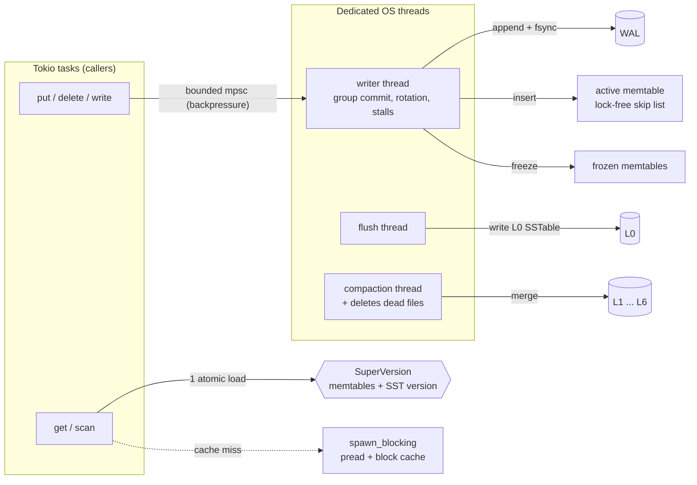

# RustLog: a disk-backed LSM-tree storage engine in Rust

A key-value storage engine in the LevelDB / RocksDB family, built from scratch on Tokio:

- a **write-ahead log** with group commit and crash recovery
- a **lock-free skip list** memtable
- **SSTables** with checksummed blocks and a **Bloom filter** per file
- **leveled compaction** on its own thread
- **no disk I/O on Tokio worker threads**, and a benchmark that measures when that matters

**Headline numbers** (MacBook, i7-9750H, 1M keys; every number comes from [`bench/`](bench/results/macos-i7-9750h.md)):

- **Crash safety:** 500 `kill -9` rounds with synced writes and 500 with buffered writes. **Zero acknowledged writes lost** (45,697 checked).
- **Bloom filters:** a lookup for a missing key reads **0.02 blocks instead of 2.45**. That's **30x the throughput** (1.88M vs 63.6k lookups/s, no block cache).
- **Keeping disk reads off Tokio:** on a slow disk (1 ms per read, like a cloud network disk), `spawn_blocking` gives **31x the read throughput** of reading on the async workers (33.8k vs 1.1k reads/s). It also keeps in-memory requests at **80 µs p50** instead of 598 µs.
- **vs RocksDB** (same settings): **0.69x** on random writes, **0.28x** on random reads, **2.8x faster** on missing-key lookups. Details and reasons [below](#benchmarks).

---

## The problem

In-memory key-value stores are easy. Real databases are bound by the disk, and that's where the hard parts are:

1. **Crashes.** A write that returned "OK" must survive `kill -9`. A half-written record must not come back as garbage.
2. **Write amplification vs read amplification.** Writing sorted files is fast. Keeping reads fast means merging those files over and over in the background.
3. **Blocking.** A disk read blocks its thread. In an async runtime like Tokio, one blocked worker thread stalls every task scheduled on it.
4. **Overload.** If background work falls behind, memory and file counts grow until something breaks.

## The approach

| Problem | Fix |
|---|---|
| Crashes | **WAL + MANIFEST**, both with a CRC32C per record. Only the newest WAL can have a torn tail, so recovery cuts it off. Damage anywhere else is reported as corruption. |
| Amplification | **Leveled compaction.** L1 and below never overlap, so a read checks at most one file per level. **Bloom filters** skip files that can't have the key. |
| Blocking | Reads that miss the cache go through **`spawn_blocking` + `pread`**. Writes go to a **dedicated writer thread**. Flush and compaction each get **their own OS thread**. |
| Overload | **Bounded everything.** A bounded write queue (callers `.await`), at most 2 frozen memtables, L0 slowdown and stop triggers, a semaphore on disk reads, and a required `limit` on scans. |

### Why not mmap?

The project spec said to read SSTables with mmap and push page faults onto `spawn_blocking`. I didn't use mmap at all:

- A disk error inside mmap is a **SIGBUS**. The process dies; there's no error to handle.
- You **can't cap** how much memory it uses.
- Any pointer access **may block** on a page fault, and you can't tell which one in advance.

These are the points from *"Are You Sure You Want to Use MMAP in Your DBMS?"* (Crotty, Leis, Pavlo, CIDR 2022). `pread` into a block cache with a fixed byte limit fixes all three. The `spawn_blocking` part stays.

---

## Architecture



### Write path

1. `put` sends the batch to the writer thread over a **bounded** channel. A full channel makes the caller wait (`.await`, not a blocked thread).
2. The writer takes **everything already queued**, appends it to the WAL with **one `write`**, and does **one `fsync`** if any write asked for it (group commit).
3. It inserts the batch into the memtable, then publishes the new sequence number. Readers only see a write after this step.
4. When the memtable is full, it's frozen, a new WAL is started, and the flush thread writes the frozen one to an L0 SSTable.

### Read path

1. Load the `SuperVersion` with one atomic load (`ArcSwap`). It holds the active memtable, the frozen memtables, and the current list of SSTables. Then load the sequence number.
2. Check the memtables. This is pure RAM, on the async task.
3. Do a **cache-only** SSTable lookup, still on the async task. If every block needed is cached, we're done, with no thread hop.
4. Otherwise, take a permit and run the lookup on `spawn_blocking`: L0 files newest first, then one file per level. For each file, the Bloom filter is checked first, then the index, then one data block.

The order in step 1 matters. Loading the state first means every SSTable entry in it is already visible to our sequence number. If you load the sequence number first, a read racing a flush plus a compaction can miss a key that compaction already merged away.

### Compaction

- **L0:** one file per flush, files may overlap. 4 or more files triggers a compaction.
- **L1 and below:** sorted, no overlaps, each level 10x the one above (L1 = 10 MB).
- Each level gets a score: L0 by file count, the others by bytes over budget. The worst level is compacted if its score is ≥ 1.
- **Round-robin** through each level's key space, so one hot range doesn't get compacted over and over.
- **Trivial move:** a file with nothing overlapping below is just relinked in the MANIFEST. No bytes are rewritten.
- **Tombstones** (delete markers) are dropped only when no deeper level has the key.
- Compaction reads **don't fill the block cache**, so they don't push out the blocks that user reads need.
- Old files are deleted when the **last reader drops its `Arc<Table>`**. The unlink is sent to the compaction thread, because `unlink` blocks and the last drop may happen on a Tokio worker.

### Crash safety

| Step | Why |
|---|---|
| WAL record = checksum, length, payload | Torn or flipped record is detected, never replayed. |
| Old WAL fsynced before switching to a new one | So only the **newest** WAL can have a torn tail. A torn tail anywhere else is real corruption. |
| New file → fsync the **directory** | Otherwise the file's data can survive a crash while its name doesn't. |
| SSTable fsynced before the MANIFEST points at it | No MANIFEST entry pointing at a file full of zeros. |
| MANIFEST edit fsynced before the new version is used | A torn last edit was never visible, so dropping it is correct. |
| `CURRENT` replaced with temp file + rename + dir fsync | A crash leaves the old name or the new one. |
| `LOCK` file with `flock` | Two processes can't open the same DB. |
| Any background I/O error → **read-only** | No retry after a failed fsync. Linux may drop the dirty pages and report success the next time ("fsyncgate", PostgreSQL 2018). |

---

## Benchmarks

Full results: [`bench/results/macos-i7-9750h.md`](bench/results/macos-i7-9750h.md). The command is at the top of that file.

**Setup:** MacBook Pro, Intel i7-9750H (6 cores / 12 threads), NVMe SSD, macOS. 1M keys, 16 B keys, 100 B values, no compression, 16 concurrent tasks (RustLog) or threads (RocksDB). RocksDB 11.8 (via `rust-rocksdb` 0.25) is set up with the same memtable size, L0 triggers, level sizes, block size, 10-bit Bloom filters, and one flush plus one compaction thread.

### RustLog vs RocksDB

| Workload | RustLog | RocksDB | RustLog / RocksDB |
|---|---:|---:|---:|
| fillseq, 1 writer | 7.2k ops/s | 53.8k ops/s | 0.13x |
| fillrandom, 16 writers | 40.8k ops/s | 58.9k ops/s | 0.69x |
| readrandom, 16 readers (8 MB cache) | 70.4k ops/s | 251k ops/s | 0.28x |
| readmissing, 16 readers | **2.74M ops/s** | 982k ops/s | **2.8x** |
| write amplification (fillrandom) | 7.09 | 5.75 | |
| space amplification | 1.07 | 1.01 | |

Why each gap exists:

- **Single-writer latency (0.13x).** Every RustLog write crosses to the writer thread and back: two thread wake-ups, ~100 µs p50 on macOS. RocksDB writes on the caller's thread. This is the price of the dedicated writer. It pays back under concurrency: 64 sync writers share one fsync per **32.7 writes**.
- **Random reads (0.28x).** The DB is ~124 MB and the cache 8 MB, so 93% of reads miss and pay a `spawn_blocking` hop. That's a thread wake-up plus a 4 KB read, allocation, and checksum per block. RocksDB reads on the caller's thread with no hop. That's the trade-off measured in the next section.
- **Missing keys (2.8x faster).** These are answered from the Bloom filters on the async task. There's no hop and no disk read.
- **Write amplification.** Recent RocksDB versions size levels dynamically (`level_compaction_dynamic_level_bytes`, on by default), so data skips the small upper levels. RustLog uses fixed level sizes, like LevelDB.
- **Sync writes aren't comparable on macOS.** RustLog's fsync is Rust's `sync_data`, which on macOS is `F_FULLFSYNC`: a real flush of the drive cache, ~20 ms (46 writes/s with 1 writer). RocksDB calls `fdatasync`, which on macOS returns before the drive cache is flushed (~0.15 ms). Run this row on Linux for a fair comparison.

### Is the Tokio runtime blocked?

The thesis test. Tokio runtime with **2 worker threads**. 64 tasks do random gets with no block cache. A plain OS thread (outside the runtime) pings a task every 500 µs. That task reads a key from the memtable (pure RAM) and replies. The round trip shows how long a request that needs **no disk** waits while the disk-bound load runs. There are no Tokio timers in the measurement, because macOS timer coalescing adds milliseconds of noise.

| Reads take | Mode | Disk reads/s | RAM request p50 | p99 |
|---|---|---:|---:|---:|
| — | idle baseline | 0 | 38 µs | 265 µs |
| ~20 µs (OS cache) | `spawn_blocking` (RustLog) | 38.3k | 450 µs | 1.6 ms |
| ~20 µs (OS cache) | `pread` on the async worker | **107k** | **90 µs** | 1.1 ms |
| 1 ms (network disk) | `spawn_blocking` (RustLog) | **33.8k** | **80 µs** | 1.4 ms |
| 1 ms (network disk) | `pread` on the async worker | 1.1k | 598 µs | 7.3 ms |

What this shows, honestly:

- **When reads are fast, `spawn_blocking` loses.** The hop costs more than a 20 µs read. Inline reads did 2.8x the throughput. (On macOS, `F_NOCACHE` doesn't evict pages that are already cached, so these "disk" reads mostly hit the OS cache.)
- **When reads are slow, `spawn_blocking` wins big.** Inline reads cap in-flight I/O at the number of workers (2), so throughput drops to 1.1k/s and RAM-only requests queue behind disk reads. With `spawn_blocking`, 64 reads are in flight and RAM requests stay near baseline.
- That's why RustLog tries a **cache-only lookup on the async task first** and only hops when it must touch the disk. The next step would be to choose per read based on measured device latency. io_uring removes the hop entirely.

### Bloom filters

| 250k keys, no block cache | Lookups/s for missing keys | Block reads per lookup |
|---|---:|---:|
| 10 bits/key | **1.88M** | **0.02** |
| off | 63.6k | 2.45 |

The measured false-positive rate is **0.85%** over 100k missing keys (unit test `false_positive_rate_near_one_percent`; theory for 10 bits/key and 7 hashes is 0.82%).

---

## Testing

| Test | What it checks |
|---|---|
| Unit tests (28) | Encoding, blocks, Bloom filter false-positive rate, cache byte limit, WAL, MANIFEST, iterators. A 1M-key SSTable round trip. **Every byte of an SSTable flipped one at a time**: each flip gives an error or the right answer, never a wrong value. |
| `tests/wal_torn.rs` | WAL **cut at every byte offset** (581 cuts). Recovery returns exactly the fully-written records. Damage in an older WAL is reported, not skipped. |
| `tests/model.rs` | **proptest**: up to 1,500 random puts, deletes, gets, scans, flushes, compactions and reopens, checked against a `BTreeMap`. |
| `tests/concurrency.rs` | 4 writers and 8 readers while flushes and compactions run. A reader never sees a key go back in time, and never misses an acknowledged write. 64 concurrent sync writers share fsyncs (group commit). |
| `tests/crash.rs` | A child process writes as fast as it can and is **`kill -9`ed at a random moment**, then the DB is reopened and checked. This repeats on the same directory, so it also recovers from interrupted flushes, compactions and recoveries. **500 rounds each** for synced and buffered writes: 2,278 + 43,419 acknowledged writes checked, **zero lost**. |
| `tests/faults.rs` | Injected failures (disk full) at WAL write, WAL fsync, SSTable write, and MANIFEST write. The DB goes read-only, reads still work, and a reopen recovers every acknowledged write. |

CI runs `fmt`, `clippy -D warnings` (with `unwrap`, `expect` and `panic` denied in library code) and all tests on Linux and macOS.

```sh
cargo test                                  # everything (~5 min on macOS: F_FULLFSYNC is slow)
CRASH_ROUNDS=500 cargo test --test crash    # the long crash run
MODEL_CASES=200 cargo test --test model     # more random cases
```

---

## Limits

Things a production engine has that this doesn't:

- **No compression.** LZ4 per block would cut disk use and I/O.
- **No user-facing snapshots or iterators.** `scan` returns a `Vec` with a required limit. Compaction drops old versions right away, because no reader can ask for them.
- **Single-writer latency.** The dedicated writer thread costs ~100 µs per write at queue depth 1 (two thread wake-ups). RocksDB instead lets the first waiting writer do the group commit on its own thread.
- **Fixed level sizes.** RocksDB's dynamic level sizing gives lower write amplification.
- **One compaction at a time.** RocksDB runs several in parallel on different key ranges.
- **Every SSTable stays open.** That's one file descriptor per file. A table cache with an LRU would cap that.
- **Unix only.** Reads use `pread`.
- **No io_uring.** Linux-only, and development was on macOS. It's the next step for the read path: thousands of reads in flight without a thread each.
- **Key ordering is plain bytes.** No custom comparators.

## Layout

```
src/
  engine.rs       Db API, open + recovery, SuperVersion
  writer.rs       writer thread: group commit, rotation, stalls
  flush.rs        memtable -> L0 SSTable
  compaction.rs   leveled compaction picker + merge
  memtable.rs     crossbeam skip list
  wal.rs          record framing, replay
  manifest.rs     version edits, CURRENT
  version.rs      levels, point lookup, level iterator
  sstable/        block format, builder, reader
  bloom.rs        Bloom filter (xxh3, double hashing)
  cache.rs        sharded CLOCK block cache
  iterator.rs     merging iterator, snapshot view
tests/            integration, model, crash, fault tests
bench/            db_bench-style benchmark, RocksDB baseline
```
